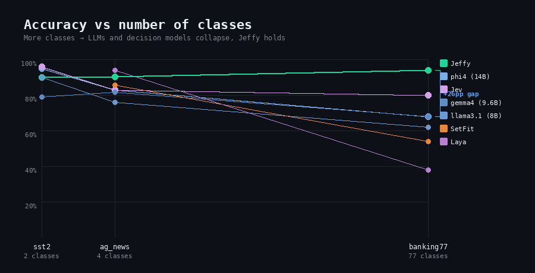
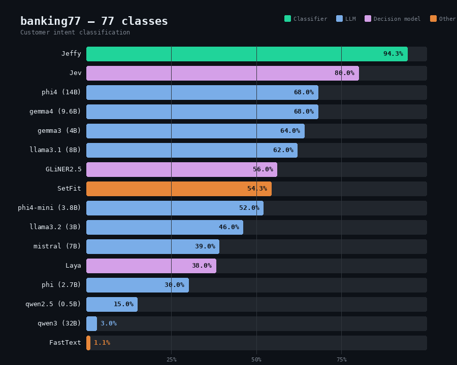

# JeffyBench

Jeffy vs 16 models on text classification: 10 local LLMs, 2 decision models, 2 traditional classifiers, and the leading hosted decision model.

**[Interactive results](https://jeffyclassify.com/benchmark/)** · **[Blog post](https://jeffyclassify.com/blog/when-llms-fail-at-classification/)**

## The key chart

As class count grows, LLMs and decision models collapse while Jeffy stays accurate. No model other than Jeffy reaches 70% on banking77 (77 classes). The crossover happens between 2 and 4 classes.



## banking77 — 77 classes (customer intent)

This is where the gap is widest. Jeffy at 94.3%, the next best model (Jev) at 80%, and the best LLM (phi4 14B) at 68%.



| Model | Type | Accuracy | Latency p50 |
|-------|------|----------|-------------|
| **Jeffy** | **classifier** | **94.3%** | **118ms** |
| Jev (hosted) | decision model | 80.0% | 134ms |
| phi4 (14B) | LLM | 68.0% | 15.4s |
| gemma4 (9.6B) | LLM | 68.0% | 696ms |
| gemma3 (4B) | LLM | 64.0% | 956ms |
| llama3.1 (8B) | LLM | 62.0% | 8.9s |
| GLiNER2.5 | decision model | 56.0% | 1.7s |
| SetFit | classifier | 54.3% | 6ms |
| phi4-mini (3.8B) | LLM | 52.0% | 181ms |
| llama3.2 (3B) | LLM | 46.0% | 143ms |
| mistral (7B) | LLM | 39.0% | 17s |
| Laya | decision model | 38.0% | 815ms |
| phi (2.7B) | LLM | 30.0% | 231ms |
| qwen2.5 (0.5B) | LLM | 15.0% | 55ms |
| qwen3 (32B) | LLM | 3.0% | 9.5s |
| FastText | classifier | 1.1% | <1ms |

### ag_news — 4 classes (news topic)

| Model | Type | Accuracy | Latency p50 |
|-------|------|----------|-------------|
| Laya | decision model | 94.0% | 273ms |
| **Jeffy** | **classifier** | **90.5%** | **80ms** |
| SetFit | classifier | 85.9% | 9ms |
| phi4 (14B) | LLM | 83.0% | 493ms |
| Jev (hosted) | decision model | 83.0% | 127ms |
| gemma4 (9.6B) | LLM | 82.0% | 969ms |
| phi4-mini (3.8B) | LLM | 81.0% | 176ms |
| mistral (7B) | LLM | 81.0% | 9s |

### sst2 — 2 classes (binary sentiment)

| Model | Type | Accuracy | Latency p50 |
|-------|------|----------|-------------|
| Jev (hosted) | decision model | 96.0% | 127ms |
| phi4 (14B) | LLM | 95.0% | 286ms |
| GLiNER2.5 | decision model | 93.0% | 336ms |
| **Jeffy** | **classifier** | **90.1%** | **104ms** |
| llama3.1 (8B) | LLM | 90.0% | 15.5s |
| gemma3 (4B) | LLM | 89.0% | 500ms |
| llama3.2 (3B) | LLM | 89.0% | 115ms |

## Run it yourself

```bash
pip install jeffy-classify datasets

# Pull an LLM to compare
ollama pull phi4

# Run the benchmark
python benchmarks/jeffybench.py --models phi4,mistral,llama3.1

# Single task
python benchmarks/jeffybench.py --tasks banking77 --models phi4
```

## Setup

- 100 held-out samples per task
- All LLMs via Ollama, temperature 0, prompted with "reply with ONLY the category name"
- Decision models get the label set at call time
- Jeffy, SetFit, and FastText trained on standard training splits
- All results in [`data/eval_results/`](../data/eval_results/)
